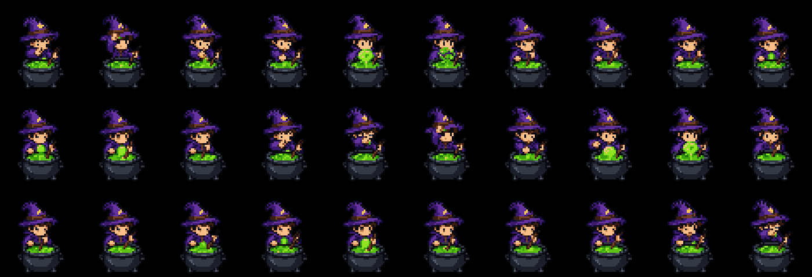

# Çırak

A tiny wizard apprentice who sits on your desktop and keeps you company while you work: a
**body double** for ADHD brains. Tell it what you're doing and now and then it asks a short,
curious question. Hold a key and talk to skip a song, turn the volume down, open an app or ask
Claude something.

- **Everything you say stays on your PC.** Speech is turned into text locally (Whisper); questions
  come from a local model (Ollama, optional) or a built-in list.
- **Voice commands:** media keys, volume, apps from your own list, "ask Claude" / "tell Claude"
  (if Claude Code is installed). Push-to-talk works over music.
- **Six looks:** wizard, blacksmith, healer, scribe, archer, cook.
- **English and Turkish.**

## Download

Windows 10/11, 64-bit: get `Cirak-<version>-setup.exe` (or the zip) from
[Releases](../../releases). Windows may say "Windows protected your PC" because the app is not
signed yet: click **More info → Run anyway**. Right-click the apprentice → **What can you do?**
for everything else.

## Türkçe

Çalışırken masaüstünde yanında oturan küçük bir büyücü çırağı (DEHB için "body double").
Ne yaptığını anlatırsan arada bir merakla soru sorar; tuşu basılı tutup konuşarak şarkı
geçer, sesi kısar, uygulama açar ya da Claude'a soru sorar. Söylediklerin bilgisayarından
çıkmaz. Kurulum dosyası [Releases](../../releases) sayfasında; çırağa sağ tıklayıp
**Neler yapabilirsin?** seç.

## Building

- `app/`: the Godot 4.7 app (`tests/run_tests.gd`)
- `listener/`: the Python 3.12 listener (Whisper, commands, Ollama); see `listener/README.md`
- `tools/build.py`: release folder, zip and Inno Setup installer

## Licence

Code: MIT ([LICENSE](LICENSE)). Drawings in `app/art/`: CC BY 4.0
([app/art/LICENSE.txt](app/art/LICENSE.txt)). Third-party parts: `LICENSES.txt` in the release.
